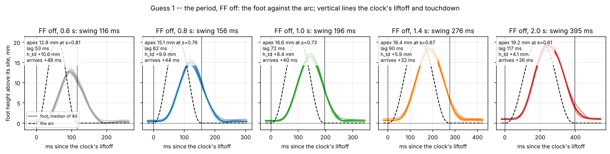
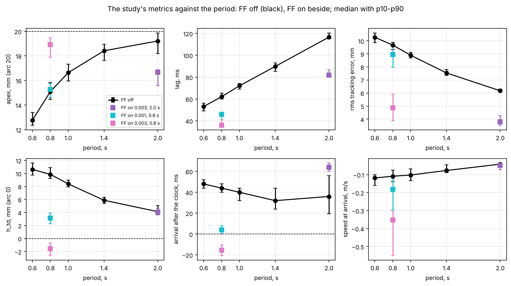
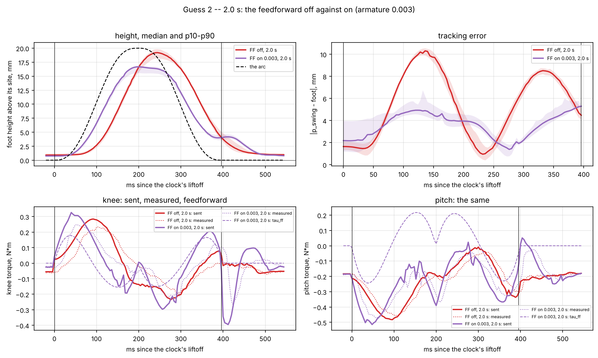
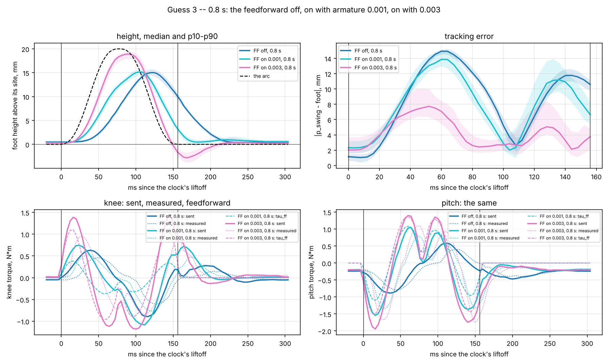
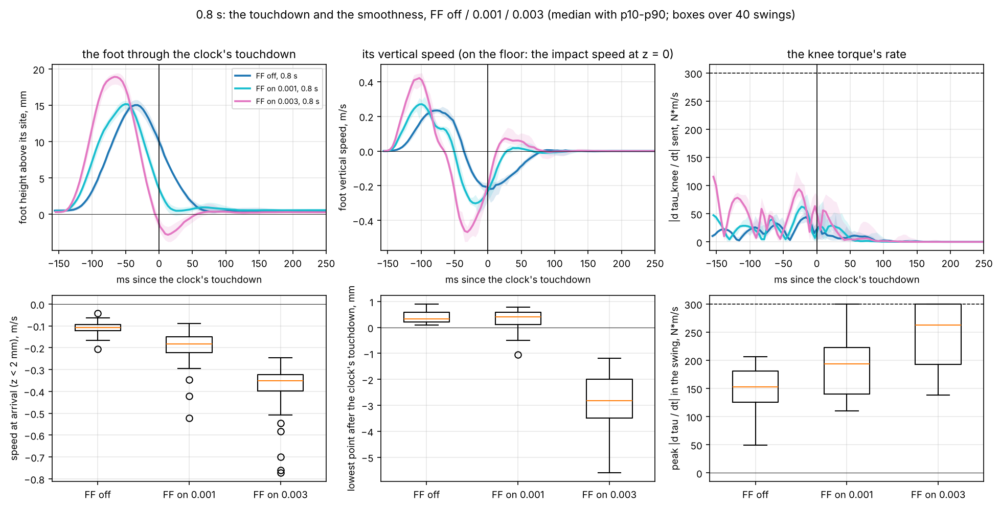
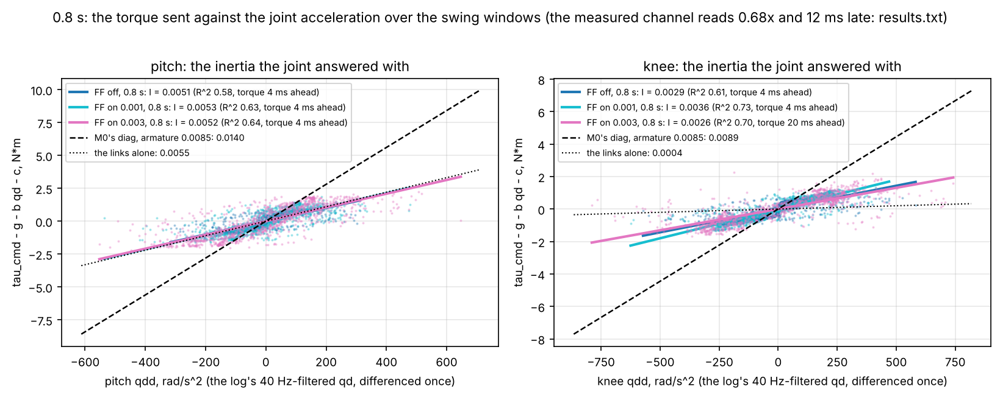

# swing-hw：挂起摆腿实测（2026-10-27，第 1 轮）对操作者三个猜想的检验

数据：`doc/swing_height/runs/b_*.npz`（分支 `swing-analysis`，提交 74fc5e1），由 `hw.swing_ff` 采集。
分析代码 `analyse.py`，全部数字在 `results.txt`，图在 `fig/`。重跑：

```
python doc/swing_hw/analyse.py            # 读 doc/swing_height/runs，写 fig/ 与 results.txt
```

## 1. 实验与指标

机器人挂起，无 IMU，FOLD2 保持姿势（躯干 160 mm），支撑腿在关节层（Kp 5 / Kd 0.2）加自身重力，
摆动腿按时间时钟（duty 0.8、ramp 0.15）走 20 mm 五次多项式弧线，walk 的笛卡尔 PD
（Kp 150/150/400 N/m，Kd 6/6/40 N·s/m），cap 9 N·m，slew 300 N·m/s。四腿各 12 次摆动，
每腿前 2 次不计，每组统计 40 次。

| 组 | 文件 | 周期 | 前馈 |
|---|---|---|---|
| B1–B5 | `b_off_T{06,08,10,14,20}_1` | 0.6 / 0.8 / 1.0 / 1.4 / 2.0 s | 关 |
| B6 | `b_ff003_T20_1` | 2.0 s | 开，armature 0.003 |
| B7 | `b_ff001_T08_1` | 0.8 s | 开，armature 0.001 |
| B8 | `b_ff003_T08_1` | 0.8 s | 开，armature 0.003 |

指标沿用 `doc/swing_height` 单腿研究的定义，高度一律取足端 FK 相对其**静止站位**（hold 的目标，
弧线的零点；在地面上该点即地面）：

- **apex**：时钟摆动窗内的最高点及其相位 s（弧线：20 mm，s = 0.5）
- **lag**：时钟抬腿到足端首次高于 4 mm 的时间
- **rms**：窗内 |p_swing − x_b| 的均方根（三维）
- **h_td**：时钟判定触地那一拍的高度（弧线：0）
- **t_arr / vz_arr**：足端实际回到 2 mm 以下的时刻（相对时钟触地，正为晚）及当时的竖直速度。
  **在地面上这就是真正的触地时刻与撞击速度。**
- **dip**：时钟触地后 150 ms 内的最低点（负值 = 低于站位；在地面上 = 压进地面）
- **rate**：发出力矩的峰值变化率 |dτ/dt|；**jerk**：足端 z 的三阶导中位数（平滑度）

## 2. 结果总表（中位数，[p10, p90]）

| 组 | 周期 / FF | apex mm | s | lag ms | rms mm | h_td mm | t_arr ms | vz_arr m/s | dip mm | x mm | τ 峰 | ff 峰 | rate N·m/s |
|---|---|---|---|---|---|---|---|---|---|---|---|---|---|
| B1 | 0.6 / 关 | 12.8 [12.4, 13.4] | 0.81 | 53 | 10.3 | +10.6 | +48 | −0.12 | +0.1 | 4.8 | 1.22 | 0 | 173 |
| B2 | 0.8 / 关 | 15.1 [14.5, 15.8] | 0.76 | 62 | 9.7 | +9.9 | +44 | −0.11 | +0.3 | 4.4 | 1.01 | 0 | 153 |
| B3 | 1.0 / 关 | 16.6 [16.0, 17.3] | 0.73 | 72 | 8.9 | +8.4 | +40 | −0.10 | +0.6 | 4.3 | 0.82 | 0 | 135 |
| B4 | 1.4 / 关 | 18.4 [17.6, 19.0] | 0.67 | 90 | 7.5 | +5.9 | +32 | −0.08 | +0.8 | 4.9 | 0.67 | 0 | 130 |
| B5 | 2.0 / 关 | 19.2 [18.2, 19.9] | 0.61 | 117 | 6.2 | +4.1 | +36 | −0.04 | +1.0 | 4.2 | 0.61 | 0 | 88 |
| B6 | 2.0 / 0.003 | 16.7 [15.6, 16.9] | 0.50 | 82 | 3.8 | +4.0 | +64 | −0.05 | +0.8 | 4.1 | 0.52 | 0.24 | 67 |
| B7 | 0.8 / 0.001 | 15.3 [14.6, 15.7] | 0.66 | 46 | 9.0 | +3.1 | +4 | −0.18 | +0.4 | 11.5 | 1.56 | 1.11 | 194 |
| B8 | 0.8 / 0.003 | 18.9 [17.9, 19.4] | 0.57 | 36 | 4.9 | −1.6 | −15 | −0.35 | −2.8 | 7.9 | 1.99 | 1.53 | 263 |

四条腿彼此一致（`fig/8_legs.png`）：同一组内 apex 极差 ≤ 1.2 mm，h_td 极差 ≤ 1.2 mm；
每次运行均无驱动器错误字节，slew 均未削峰（clip 0）。

## 3. 猜想 1：周期

> 短周期躯干稳，但摆腿跟不上弧线，触地早或晚；长周期跟得上，但躯干两次修正间隔太长。




**腿的一半成立，且有一处需要修正。**

- 跟踪随周期单调改善：apex 12.8 → 19.2 mm，h_td +10.6 → +4.1 mm，rms 10.3 → 6.2 mm。
  lag 占摆动期的比例 46 % → 29 %，apex 相位 0.81 → 0.61——PD 的滞后是固定的几十毫秒，
  周期越长它占的份额越小。
- **但"触地晚"几乎不随周期改善**：t_arr 在 0.6–2.0 s 之间始终是 +32 ~ +48 ms。
  原因在弧线末段：五次多项式以零速度到达站位，最后几毫米下降极慢，PD 滞后的脚总要再花
  30–50 ms 才能走完。改善的是撞击速度 vz_arr（−0.12 → −0.04 m/s）和时钟触地时的悬空高度
  （h_td），不是迟到本身。在 0.8 s 的小跑里，脚在时钟交付载荷时仍离地约 10 mm，再过 44 ms
  才碰地，这就是时间时钟与真实触地的错位。
- 在 FF 关的条件下**没有任何周期能到 20 mm**；2.0 s 也只有 19.2 mm，且 apex 仍在 s = 0.61。
- 躯干那一半（F1–F5 地面组）尚未飞，本轮数据不能检验。

## 4. 猜想 2：2.0 s 时打开前馈

> 周期 2.0 时 FF 开跟踪快，FF 关滞后。



**相位成立，幅值不成立。**

- 快：lag 117 → 82 ms，apex 相位 0.61 → 0.50（正落在弧线的顶点时刻），rms 6.2 → 3.8 mm，
  窗内误差从 10 mm 的双峰变成 5 mm 的平台。
- 低：apex 19.2 → **16.7 mm**。395 ms 的弧线只要求 0.24 N·m 的前馈，PD 仍是主力；前馈的
  第二段（顶点前的减速）按弧线时刻提前施加，而脚此时还在弧线下方 4 mm，于是被提前刹住。
- 落地更晚：t_arr +36 → +64 ms。弧线末段前馈为正（刹住下落），脚还在 4 mm 高处就被托住。
  h_td 不变（+4.1 / +4.0）。
- 这一组里前馈的"快"是相位超前，不是力矩——与第 6 节的惯量拟合一致：在长周期下惯量项
  本身太小，前馈几乎只改变时序。

## 5. 猜想 3：0.8 s 时 armature 0.003 对 0.001 对关

> 0.8 s 下 FF 开（0.003）比关更接近 20 mm，且比 0.001 跟得好。




**成立，并且代价被量化。**

- 高度：apex 15.1（关）/ 15.3（0.001）/ **18.9**（0.003）mm；rms 9.7 / 9.0 / **4.9** mm；
  apex 相位 0.76 / 0.66 / 0.57。0.001 的前馈峰 1.1 N·m 只够改时序，不够改高度；
  0.003 的 1.5 N·m 才把弧线抬起来。
- 操作者感到的"更快但不平滑、落地更重"在数据里是三件事：
  1. **撞击速度**：vz_arr −0.11 → −0.18 → **−0.35 m/s**，0.003 是关的三倍；
     p90 到 −0.5 m/s，个别次 −0.8。
  2. **提前并压过站位**：t_arr +44 → +4 → **−15 ms**，h_td +9.9 → +3.1 → **−1.6 mm**，
     dip +0.3 → +0.4 → **−2.8 mm**（p90 −3.5，最深 −5.7）。在地面上，脚在时钟交付载荷
     前 15 ms 已经以 0.35 m/s 砸到地面，然后 PD + 前馈继续把它往下压 3 mm，支撑载荷再叠上来。
  3. **粗糙**：力矩峰值变化率 153 → 194 → **263 N·m/s**（膝 p90 41 → 98），
     足端 jerk 610 → 1531 → **2354 m/s³**。膝力矩在 s ≈ 0.5 处有一次反向（图 4 左下），
     0.003 时反向幅度 2 N·m 在 30 ms 内完成，接近 300 的 slew。
- 侧向：x 偏移 4.4 → **11.5**（0.001）→ 7.9（0.003）mm（`fig/6_foot_path.png`）。
  弧线本身没有 x；x 来自前馈的几何项 J⁺(a − J̇q̇)。改 armature 改的是 M0 的**对角比例**
  （pitch/knee：真实 M0 1.6，0.003 时 2.5，0.001 时 4.6），比例失真直接变成 x 推力，
  0.001 比 0.003 更歪正是这个原因。

## 6. 腿实际回应的惯量：前馈该乘多少



对每个摆动窗做 τ − g = I q̈ + b q̇ + c 的最小二乘（q̈ 由日志里 40 Hz 滤波的 q̇ 微分，允许力矩
领先 0–20 ms），0.8 s 的三组给出一致的答案（发出力矩，R² 0.58–0.73）：

| 关节 | 拟合 I（B2 / B7 / B8） | 连杆自身（CAD，armature 除外） | M0 默认（armature 0.0085） | 拟合 / M0 |
|---|---|---|---|---|
| pitch | 0.0051 / 0.0053 / 0.0052 | 0.0055 | 0.0140 | **0.36–0.38** |
| knee | 0.0029 / 0.0036 / 0.0026 | 0.0004 | 0.0089 | **0.29–0.40** |

- 腿对一个发出的 N·m 的响应，是模型 M0 的 **约 1/3**。pitch 的拟合值几乎只等于连杆自身
  （称重模型给 0.0046），膝的转子项约 0.002–0.003，远低于按 10:1 减速折算的 0.0085。
  这与 09-25 台架的"腿以模型 1.7 倍的动作回应模型的力矩"和今天 0.0085 立即过压一致。
- 驱动器回报的力矩只有指令的 **0.68 倍**、晚 **12 ms**（八组一致，`results.txt`），说明
  "指令 N·m → 实际 N·m"这段链路本身有增益和延迟；前馈需要的是**按指令力矩计**的有效惯量，
  即上表。用回报力矩拟合的数值更低且不稳定，不采用。
- armature 0.003 的 M0 对角是 0.0084 / 0.0034，仍是拟合值的 1.6 / 1.2 倍——这解释了 B8 的
  apex 相位提前（0.57）、落地提前 15 ms 和压过站位 2.8 mm：前馈仍然略多，多出的部分在下落段
  变成额外的向下加速度。0.001 的 M0（0.0065 / 0.0014）pitch 偏多、knee 偏少，两关节不协调，
  于是 x 偏移最大。
- 周期越长拟合 R² 越低（2.0 s 时 0.36），因为加速度小、摩擦项占比大；拟合以 0.8 s 为准。
- 注意事项：q̇ 的 40 Hz 低通和指令到力矩的延迟都会把斜率压低，膝的最佳领先量落在搜索边界
  20 ms，膝的数字可靠性低于 pitch；取 0.35 ± 0.05 作为当前最佳估计。

**结论：前馈不应通过改 armature 来缩放，而应保留完整 M0 的形状、整体乘 ≈ 0.35。**
这样 pitch/knee 比例保持 1.6（与拟合的 1.7 相符），x 推力随之消失，幅值又正好是腿实际
回应的量。

## 7. 对"不平滑、冲击大"的解释与建议

1. **根因是时间时钟 + 略多的前馈**：前馈让脚按弧线时刻到达，弧线末段的正前馈（刹车）
   与 PD 把脚压过站位，时钟还要等 15 ms 才换相。在地面上这是先撞击、再压地、再承载三连击。
   FF 关时则相反：脚迟到 44 ms、悬空 10 mm 时就被交付载荷。两者都是时钟与脚的错位，方向相反。
2. **立即可做（代码）**：
   - `--ff-scale 0.35`（完整 M0 × 系数），替代 `--ff-armature 0.003`；预期 apex 保持 ≈ 19 mm，
     dip 回到 0 附近，x 偏移降回 4 mm 级。
   - 前馈末段渐隐（例如 s > 0.75 后线性归零），让脚带着 PD 而不是带着反向前馈落地；
     预期 vz_arr 从 −0.35 回到 −0.15 m/s 一级。
   - Kd 40 → 60–65（ζ 0.42 → 0.65）：减少 PD 一侧的过冲和力矩反向幅度，不改带宽。
3. **电源**：DC 电源不吸收回馈，是 armature 只能到 0.003 的直接原因；按本节的拟合，正确的
   前馈幅值本来就只有 M0 的 1/3，与 0.003 相当，所以在加制动电阻前 `--ff-scale 0.35` 已经
   接近可用上限，不必追求 0.0085。
4. **周期**：FF 关时 1.0 s 比 0.8 s 只多 1.5 mm apex、少 1.5 mm h_td，迟到仍 40 ms；
   把前馈调对比拉长周期收益大得多。周期的取舍应留给地面组 F1–F5（躯干稳定性）决定。
5. **中期**：真实触地检测替代纯时间换相（10-20 的方案 A 已回退），或 walk 的 `osc` 律。

## 8. 下一轮建议的组

- 第 2、3 轮重复 B2 / B8，确认 40 次中位数的可重复性（本轮同组四腿极差 ≤ 1.2 mm，
  预期可重复）。
- 新增 0.8 s：`--ff-scale 0.35`、`--ff-scale 0.35 + 末段渐隐`、`--ff-scale 0.35 --kd-swing 6 6 65`，
  各 12 次/腿，比较 apex、t_arr、vz_arr、dip、x。
- 地面 F1–F5 与一组 F2 + 前馈（0.35），把躯干 rpy 与足端 h_td 放到同一张时钟图上。
